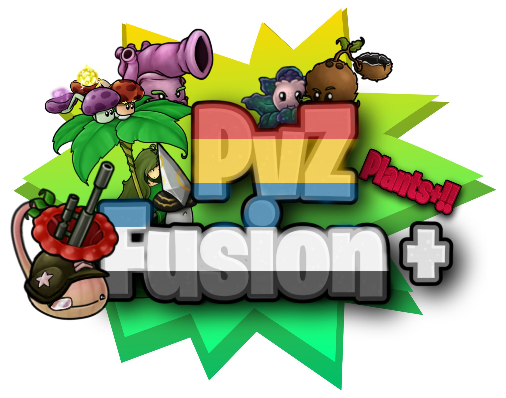

# PvZ Fusion+ 1.3.0

[Français](README_FR.md)

More plants, new fusions and Night Roof content for **Plants vs. Zombies Fusion 4.0.5.2**.

## Installation

Requires PvZ Fusion **4.0.5.2**, MelonLoader **0.7.3**, and [CustomizeLib.MelonLoader **4.0.5.2-ml.5**](https://github.com/Hubtech280/CustomizeLib.Melonloader/releases/tag/v4.0.5.2-ml.5).

1. Close the game. Install MelonLoader and run the game once if you have not already.
2. Install the CustomizeLib version linked above, keeping only one copy.
3. Remove old PlantsPlus.dll / PvZFusionPlus.dll copies from Mods.
4. Download the mod ZIP from [Releases](https://github.com/Hubtech280/PlantsPlus/releases). Extract its Mods folder beside the game executable, or copy Mods/PvZFusionPlus.dll into the game's Mods folder.
5. Start the game. The log should say **PvZ Fusion+ 1.3.0 loaded!**

The source-code ZIP is not the installable mod. The game, loader and CustomizeLib are not bundled.

## What's included

- 42 custom plant Almanac entries, including Bamboom and Solstice-shroom.
- Night Roof Adventure content and Normal, Hard and Endless Survival entries.
- Boreal Plants category and persistent Almanac favorites. Grey heart: not favorited; red heart: favorited.
- English, French and Chinese mod text. With the optional translation mod, Fusion+ follows its selected language; without it, Fusion+ uses Chinese.
- Language-specific logos and the mod's own changelog window.

Bounce-shroom and its fusions may be planted **without pots** on Roof and Night Roof. Other plants keep their own support requirements. Bumping-shroom requires **three Lob-shrooms on one tile + Bounce-shroom**. Solstice-shroom is **Bounce-shroom + Sunflower** and drops **25 Sun per zombie successfully bounced**.

Favorites are stored locally in Mods/PlantsPlusData/favorites.txt; extracted music is cached in Mods/PlantsPlusAudio. Neither folder is bundled. Keep your favorites file when updating.

The larger planned Adventure/menu reworks are **not** included.

## Known issue

ArgumentOutOfRangeException messages have been observed in zombie damage/armor-loss paths, including Zombie.AnimLoseActive and Zombie.FirstArmorFall. No visible gameplay problem was reported during that test, but the cause and impact have not been established. This release does not claim those errors are fixed.

## Building

Requires Windows, a .NET SDK able to target .NET 6, and a local game installation with generated MelonLoader/Il2CppAssemblies. Game assemblies are not redistributed.

Run BUILD_RELEASE.bat with the game directory as its argument, or run tools/build_release.ps1 -GameDirectory "C:\Path\To\Game Files". The builder compiles the mod, runs offline text/metadata/favorites checks and creates a ZIP with checksums under artifacts. It never launches the game or installs the DLL. Offline checks do not replace gameplay tests.

## Bugs and credits

[Report a bug](https://github.com/Hubtech280/PlantsPlus/issues) with game, library and mod versions, reproduction steps and the full MelonLoader/Latest.log. Review personal paths before posting logs publicly.

Mod creator and concepts: **Auro**. Plant/fusion artwork: **Red Reel, Retrosphere, Aris and Roshade**. Original CustomizeLib: **Infinite75**; MelonLoader port: **Hubtech280**.

See [release notes](GITHUB_RELEASE_NOTES.md), [changelog](CHANGELOG.md) and [notice](NOTICE.md). Unofficial fan mod, not affiliated with EA, PopCap or the PvZ Fusion developers.
