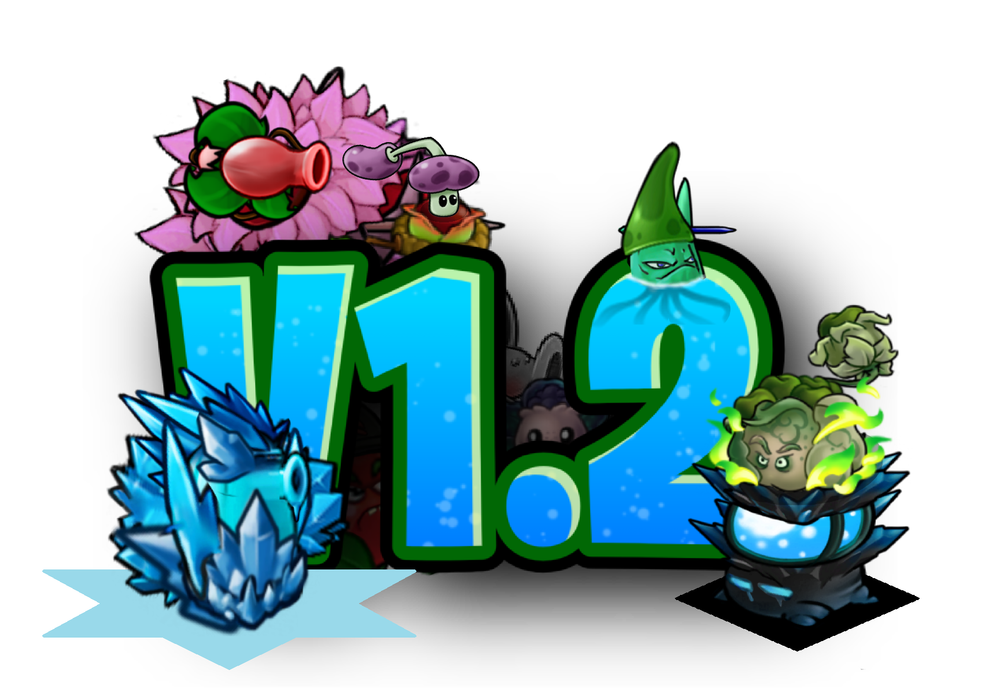

# Plants+

**Plants+** est un mod de contenu pour **Plants vs. Zombies Fusion 3.9**.

La version **1.2.1** est le hotfix de compatibilité PvZ Fusion 3.9 de la v1.2. Elle conserve les **32 plantes personnalisées** de la v1.2.0 et adapte leurs mécaniques aux changements introduits dans PvZ Fusion 3.9.

## Prérequis

- Plants vs. Zombies Fusion **3.9**
- MelonLoader **0.7.3**
- **CustomizeLib.MelonLoader 3.9.0-ml.1**

> Plants+ **v1.2.1 cible PvZ Fusion 3.9**. Si tu restes sur PvZ Fusion 3.8.1, utilise Plants+ v1.2.0.

## Plantes incluses

| ID | Plante | Type | Recette / création |
|---:|---|---|---|
| 6000 | Lotus Pumpkin | Basic Cross Fusion | Pumpkin + Snow Lotus |
| 6001 | Bambnut | Basic Cross Fusion | Bamblock + Wall-nut |
| 6002 | Magnet-o-pea | Basic Cross Fusion | Peashooter + Magnet-shroom |
| 6003 | Iceberg-shroom | Basic Double Fusion | Ice-shroom + Ice-shroom |
| 6004 | Witchfire Pumpkin | Weak Odyssey | Pyro Pumpkin + Doom Pumpkin |
| 6005 | Nutty Sharpshooter | Basic Cross Fusion | Spruce Sharpshooter + Wall-nut |
| 6006 | Inferno Torchflower | Advanced Alt | Infernowood + Sunflower |
| 6007 | Pumpkin Podbomber | Advanced Alt | Explode-o-shooter + Pumpkin |
| 6008 | Ceasarweed | Advanced Alt | Salad-pult + Spikeweed |
| 6009 | Solar Firnace | Special Cross Fusion | Firnace absorbe le Sunflower placé dessous |
| 6010 | Not-a-pea | Basic Fusion | Saw-me-not + Peashooter |
| 6011 | Not-a-storm Commando | Strong Odyssey | Saw-me-not + Pea-storm Commando |
| 6012 | Frost Furflower | Advanced Fusion | Hoarfrost Lichen + Sunflower |
| 6013 | Doomtronion | Electric Fusion | Amp-nion + Doom-shroom |
| 6014 | Lichen-pea | Basic Fusion | Hoarfrost Lichen + Peashooter |
| 6015 | Logic Blover | Harvest Red Card | Exclusif au Harvest ; aucune recette |
| 6016 | Solar Sharpshooter | Basic Fusion | Spruce Sharpshooter + Sunflower |
| 6017 | Sea Ballista | Aquatic Fusion | Spruce Ballista + Sea-shroom |
| 6018 | Pineshooter | Basic Fusion | Peashooter + Spruce Sharpshooter |
| 6019 | Icytronion | Electric Fusion | Amp-nion + Ice-shroom |
| 6020 | Sea Sharpshooter | Aquatic Fusion | Spruce Sharpshooter + Sea-shroom |
| 6021 | Cherry StarBomber | Epic Odyssey | Starfruit + Peashooter |
| 6022 | Three-Buckpeater | Basic Fusion | Threepeater + Bucket |
| 6023 | Sakura Sharpshooter | Basic Fusion | Cherry Bomb + Spruce Sharpshooter |
| 6025 | Bomber Drone | Basic Fusion | Cherryshooter + Blover |
| 6026 | Ice-Lord Cactus | Odyssey | Ice Cactus + Iceberg-shroom |
| 6027 | Scovilia Pepper | Basic Fusion | Jalapeno + Jalapeno |
| 6028 | Atomray-shroom | Odyssey | Plantern + Fume-shroom |
| 6029 | Sauerkraut-pult | Odyssey | Garbage-pult + Pepper Popper |
| 6030 | Cherry Cabbage | Basic Fusion | Cherry Bomb + Cabbage-pult |
| 6031 | Frostbite Drone | Basic Fusion | Snow Pea + Blover |
| 6032 | Lob-shroom | Basic Fusion | Lanceur de spores empilable |

> **Boreal Orchid (ID 6024) reste repoussée et n'est pas incluse dans Plants+ v1.2.1.**

## Nouveautés de la v1.2.1

La v1.2.1 est avant tout un **hotfix de compatibilité pour PvZ Fusion 3.9**. Elle n'ajoute pas de nouvelle plante personnalisée.

- Mise à jour de Plants+ pour les changements de projectiles et de déplacement de PvZ Fusion 3.9.
- Adaptation de la gestion des PV des zombies aux valeurs plus grandes utilisées par la 3.9.
- Rétablissement du comportement des projectiles perforants, des scies et des projectiles en cloche affectés par la mise à jour.
- Correction des tirs anti-aériens d'**Ice-Lord Cactus** afin de conserver le ciblage aérien natif du Cactus.
- Présentation des modifiers Odyssey adaptée à PvZ Fusion 3.9.
- Ajout de l'interaction Odyssey **Reaping Collision** entre Grim Arbiter et Cryolina Reaper.
- Ajout de l'intégration du skin **Excavator Obsidian Spike** pour l'Obsidian Spike-nut natif.
- Tout le contenu de la v1.2 et les 32 plantes personnalisées sont conservés.

## Installation

1. Installe MelonLoader 0.7.3 pour PvZ Fusion 3.9.
2. Place `CustomizeLib.MelonLoader.dll` **v3.9.0-ml.1** dans le dossier `Mods` du jeu.
3. Supprime toutes les anciennes copies de `PlantsPlus.dll`.
4. Place le `PlantsPlus.dll` de Plants+ v1.2.1 dans le dossier `Mods`.
5. Lance le jeu et vérifie la présence de `Plants+ 1.2.1 loaded!` dans le log MelonLoader.

Ne conserve pas une ancienne version de CustomizeLib en même temps que la version 3.9.

## Documentation

- [Mécaniques des plantes](docs/PLANTS_FR.md)
- [Historique des versions](CHANGELOG.md)
- [README anglais](README.md)
- [Modèle de release GitHub](docs/GITHUB_RELEASE_TEMPLATE.md)

## Compilation

Le projet cible `.NET 6` et référence les assemblies générées par MelonLoader.

Lance `BUILD_RELEASE.bat` puis sélectionne ton dossier PvZ Fusion 3.9. Le script compile Plants+, crée l'archive de release, génère le hash du binaire et peut installer la DLL obtenue dans le dossier `Mods` du jeu.

Les assemblies du jeu et CustomizeLib ne sont pas redistribuées dans ce dépôt.

## Signaler un bug

Ouvre une issue et joins le log MelonLoader complet. Indique la plante ou la mécanique concernée et les étapes exactes qui provoquent le problème.

## Crédits

- Créateur du mod et concepts des plantes : **Auro**
- Dessins des plantes et fusions : **Red Reel**, **Retrosphere**, **Aris** et **Roshade**
- Créé pour la communauté de modding PvZ Fusion avec CustomizeLib

## Avertissement

Plants+ est un mod de fan non officiel. Il n'est ni affilié ni approuvé par Electronic Arts, PopCap Games ou les développeurs de PvZ Fusion. Plants vs. Zombies et les noms associés appartiennent à leurs propriétaires respectifs.
